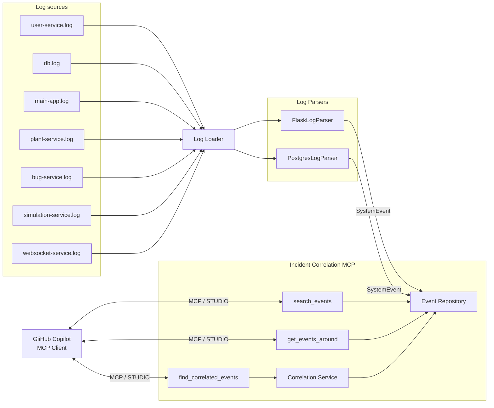
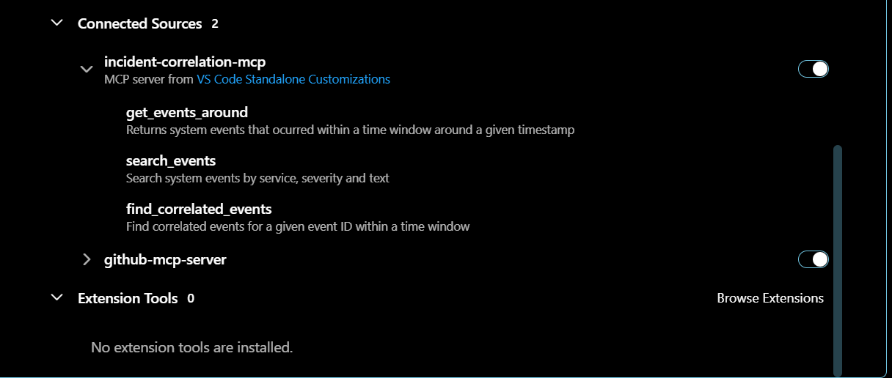
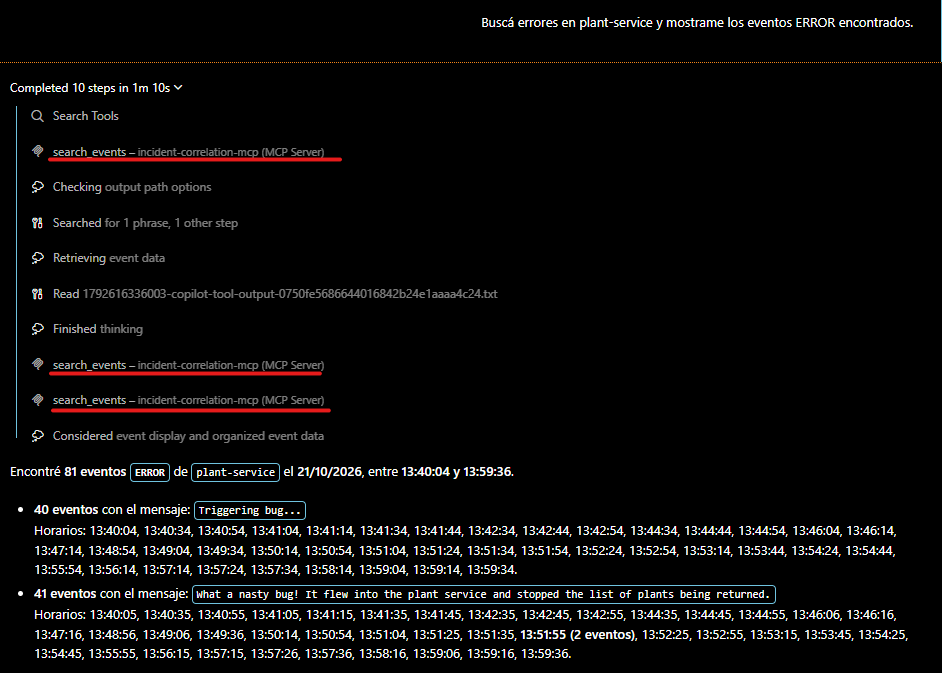
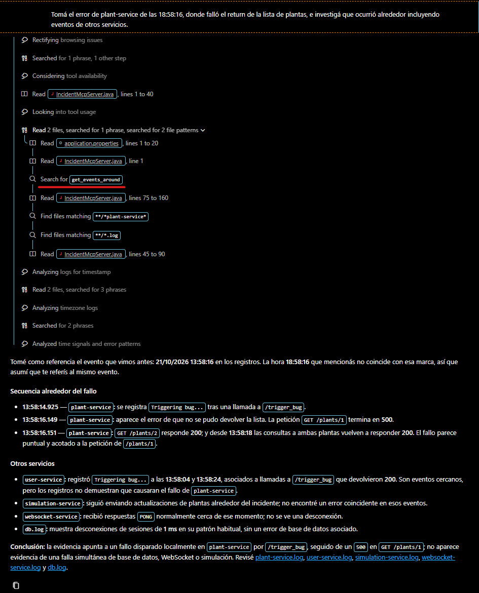
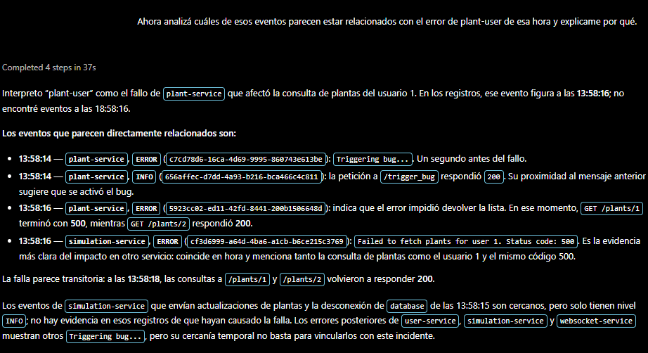
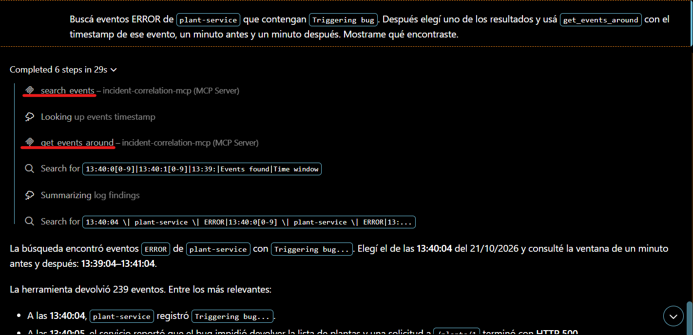

# Incident Correlation MCP
Servidor MCP desarrollado en Java para asistir en la investigación de incidentes técnicos mediante el análisis de logs provenientes de múltiples servicios. 
El proyecto expone herramientas que pueden ser descubiertas e invocadas por clientes compatibles con **Model Context Protocol (MCP)**, como **Visual Studio Code con GitHub Copilot en Agent Mode**.
El objetivo es permitir que el agente de IA pueda buscar errores, analizar eventos cercanos temporalmente y detectar posibles relaciones entre eventos de diferentes servicios.

---

## Caso de uso
En arquitecturas distribuidas, un incidente puede generar errores en múltiples componentes al mismo tiempo.
Por ejemplo:
```text
Database
    ↓
PostgreSQL todavía no está disponible

User service
    ↓
Connection refused

Database
    ↓
Ready to accept connections

User service
    ↓
Application started successfully
```
Analizar únicamente el log de 'user-service' permite detectar el error, pero no necesariamente entender qué estaba ocurriendo en otros componentes en ese mismo momento.
Este MCP permite que un agente investigue el incidente utilizando distintas herramientas especializadas.

---

## Arquitectura
El servidor sigue una arquitectura simple y desacoplada, separando la integración MCP de la carga, búsqueda y correlación de eventos.



---
### Flujo de datos

```text
📄 Logs de múltiples servicios
          │
          ▼
    🔄 Log Loader
          │
          ▼
    Parsers especializados
          │ 
          ▼
   📋 SystemEvent normalizado
          │
          ▼
   📚 Event Repository
          │
     ┌────┴──────────────┐
     │                   │
     ▼                   ▼
🔎 Búsqueda       ⚙️ Correlación
     │                   │
     └─────────┬─────────┘
               ▼
        🧠 MCP Server
               │
          MCP / STDIO
               │
               ▼
     💻 GitHub Copilot
               │
               ▼
         👤 Usuario
```


---

### Componentes
| Componente | Responsabilidad |
|---|---|
| **MCP Client** | GitHub Copilot descubre e invoca las tools mediante MCP |
| **Incident Correlation MCP** | Expone las capacidades del servidor |
| **search_events** | Busca eventos por servicio, severidad o contenido |
| **get_events_around** | Recupera eventos dentro de una ventana temporal |
| **find_correlated_events** | Identifica eventos potencialmente relacionados |
| **Correlation Service** | Calcula el score y las razones de correlacion |
| **Event Repository** | Mantiene y consulta los eventos cargados en memoria |
| **Log Loader** | Lee los archivos de log y delega su interpretación |
| **FlaskLogParser** | Interpreta logs estructurados de los servicios Flask |
| **PostgresLogParser** | Interpreta logs generados por PostgreSQL |
| **SystemEvent** | Representación común utilizada internamente |
| **Log Sources** | Logs generados por los servicios del entorno Greenhouse |

---

### Modelo interno
Los logs provenientes de distintos componentes se transforman a un modelo común antes de ser procesados:
```java
SystemEvent(
    id,
    service,
    timestamp,
    severity.
    message
)
```
Esta separación permite desacoplar la fuente de datos de la lógica de correlación.

Actualmente los eventos provienen de archivos locales, pero el mismo diseño permite reemplazar posteriormente la fuente por **Grafana Loki** sin modificar las tools expuestas por el servidor MCP.


## Tecnologías utilizadas

- Java 21
- Maven
- Model Context Protocol Java SDK
- MCP STDIO Transport
- Visual Studio Code
- GitHub Copilot Agent Mode
- MCP Inspector
- Docker Compose
- Grafana Loki Fundamentals / Greenhouse para generar los logs de prueba

---

## Dataset

Los logs utilizados por el proyecto fueros generados a partir del entorno de ejemplo de **Grafana Loki Fundamentals / Greenhouse**, ejecutando localmente mendiante Docker Compose.

Se utilizaron logs provenientes de distintos componentes:
- `user-service`
- `database`
- `main-app`
- `plant-service`
- `bug-service`
- `simulation-service`
- `websocket-service`

Los archivos se encuentran en: 
```text
src/main/resources/logs/
```

Ejemplo de estructura:

```text
logs/
├── bug-service.log
├── db.log
├── main-app.log
├── plant-service.log
├── simulation-service.log
├── user-service.log
└── websocket-service-service.log
```

El servidor carga todos los archivos al iniciar y transforma sus registros en eventos normalizados.

---

## MCP Tools

El servidor expone tres herramientas.

### 1. `search_events`

Permite buscar eventos utilizando filtros opcionales.

#### Parámetros

```json
{
  "service": "user-service",
  "severity": "ERROR",
  "text": "connection refused"
}
```

Los parámetros permiten filtrar por:

- servicio;
- severidad;
- contenido del mensaje.

#### Ejemplo de uso

```text
Buscá errores de conexión en user-service.
```

Esta tool permite localizar inicialmente un incidente o evento de interés.

---

### 2. `get_events_around`

Busca eventos ocurridos dentro de una ventana temporal alrededor de un timestamp determinado.

#### Parámetros

```json
{
  "timestamp": "2026-10-15T16:29:23",
  "minutesBefore": 1,
  "minutesAfter": 2
}
```

#### Ejemplo de uso

```text
¿Qué ocurrió alrededor de ese error?
```

Esta herramienta permite investigar qué estaba ocurriendo en otros servicios antes y después de un incidente.

---

### 3. `find_correlated_events`

Analiza los eventos cercanos a un evento origen y devuelve posibles correlaciones ordenadas mediante un score.

#### Parámetros

```json
{
  "eventId": "EVENT_ID",
  "windowMinutes": 2
}
```

#### Criterios de correlación

Actualmente el score considera factores como:

- proximidad temporal;
- mismo servicio;
- severidad del evento;
- referencias entre servicios dentro de los mensajes.

El score representa una **correlación potencial**.

> Correlación no implica necesariamente causalidad.

La interpretación final del incidente queda a cargo del agente de IA utilizando la información devuelta por las tools.

---

## Flujo de investigación

Una conversación típica puede producir el siguiente flujo:

```text
Usuario
   │
   │ "Buscá errores de conexión en user-service"
   ▼
search_events
   │
   ▼
Evento encontrado
   │
   │ "¿Qué ocurrió alrededor?"
   ▼
get_events_around
   │
   ▼
Eventos de múltiples servicios
   │
   │ "¿Cuáles parecen estar relacionados?"
   ▼
find_correlated_events
   │
   ▼
Eventos correlacionados + score + razones
   │
   ▼
GitHub Copilot
   │
   ▼
Análisis del incidente
```

---

## Estructura del proyecto

```text
incident-correlation-mcp/
│
├── pom.xml
├── .vscode/
│   └── mcp.json
│
└── src/
    └── main/
        ├── java/
        │   └── com/capsula/mcp/incidentcorrelationmcp
        │       ├── IncidentMcpServer.java
        │       │
        │       ├── loader/
        │       │   ├── FlaskLogParser.java
        │       │   ├── LogLoader.java
        │       │   ├── LogParser.java
        │       │   └── PostgresLogParser.java   
        │       │
        │       ├── model/
        │       │   ├── SystemEvent.java
        │       │   ├── Severity.java
        │       │   └── CorrelationResult.java
        │       │
        │       ├── repository/
        │       │   └── EventRepository.java
        │       │
        │       └── service/
        │           └── CorrelationService.java
        │
        └── resources/
            └── logs/
                ├── bug-service.log
                ├── db.log
                ├── main-app.log
                ├── plant-service.log
                ├── simulation-service.log
                ├── user-service.log
                └── websocket-service.log
```

---

## Requisitos

Para ejecutar el proyecto se necesita:

- Java 21 o superior
- Maven
- Node.js / `npx` para utilizar MCP Inspector
- Visual Studio Code
- GitHub Copilot

### Verificar Java

```bash
java -version
```

### Verificar Maven

```bash
mvn -version
```

---

## Compilar el proyecto

Desde la raíz:

```bash
mvn clean package
```

Se genera un JAR ejecutable en:

```text
target/incident-correlation-mcp-0.0.1-SNAPSHOT.jar
```

---

## Ejecutar localmente

El servidor utiliza transporte **STDIO**.

Puede ejecutarse manualmente mediante:

```bash
java -jar target/incident-correlation-mcp-0.0.1-SNAPSHOT.jar
```

El proceso permanecerá activo esperando que un cliente MCP se comunique mediante `stdin/stdout`.

Los logs internos del servidor se escriben utilizando `stderr`, ya que `stdout` queda reservado para la comunicación MCP.

---

## Probar con MCP Inspector

Ejecutar:

```bash
npx @modelcontextprotocol/inspector java -jar target/incident-correlation-mcp-0.0.1-SNAPSHOT.jar
```

Desde MCP Inspector se pueden verificar las tools disponibles:

```text
search_events
get_events_around
find_correlated_events
```

También se pueden invocar manualmente para validar sus parámetros y respuestas.

---

## Conexión con Visual Studio Code

Crear el archivo:

```text
.vscode/mcp.json
```

Con la siguiente configuración:

```json
{
  "servers": {
    "incident-correlation-mcp": {
      "type": "stdio",
      "command": "java",
      "args": [
        "-jar",
        "${workspaceFolder}/target/incident-correlation-mcp-0.0.1-SNAPSHOT.jar"
      ],
      "cwd": "${workspaceFolder}"
    }
  }
}
```

Antes de iniciar el servidor:

```bash
mvn clean package
```

Luego abrir el proyecto desde Visual Studio Code.

Al iniciar el servidor MCP, VS Code debería indicar:

```text
Discovered 3 tools
```

Las herramientas descubiertas son:

```text
search_events
get_events_around
find_correlated_events
```

Esto permite verificar que el cliente realizó correctamente el descubrimiento de las tools expuestas por el servidor antes de utilizarlas.

---

## Integración con GitHub Copilot Agent

Una vez iniciado el servidor MCP:

1. Abrir GitHub Copilot Chat.
2. Seleccionar **Agent Mode**.
3. Verificar que las tools del servidor MCP aparezcan disponibles.
4. Ejecutar consultas utilizando lenguaje natural.

Por ejemplo:

```text
Buscá errores de conexión en user-service y analizá qué ocurrió alrededor.
```

El agente puede decidir invocar:

```text
search_events
      ↓
get_events_around
```

Posteriormente:

```text
Analizá qué eventos parecen estar relacionados con ese error.
```

El agente puede utilizar:

```text
find_correlated_events
```

De esta manera se demuestra que el cliente:

1. se conecta al servidor MCP;
2. descubre las tools disponibles;
3. selecciona automáticamente las herramientas necesarias;
4. las invoca utilizando el protocolo MCP;
5. utiliza los resultados para construir una respuesta.

---

## Caso de prueba real

Uno de los incidentes utilizados para probar el proyecto ocurrió durante el inicio del entorno Greenhouse.

`user-service` intentó conectarse a PostgreSQL y recibió:

```text
connection to server at "db", port 5432 failed:
Connection refused
```

En ese momento PostgreSQL todavía se encontraba inicializándose.

Posteriormente la base informó:

```text
database system is ready to accept connections
```

y `user-service` pudo iniciar correctamente.

Una investigación mediante el MCP puede comenzar con:

```text
Buscá errores de conexión en user-service.
```

El agente utiliza:

```text
search_events
```

Luego:

```text
Investigá qué ocurrió alrededor de ese error.
```

puede provocar:

```text
get_events_around
```

Finalmente:

```text
¿Qué eventos parecen estar relacionados y por qué?
```

puede provocar:

```text
find_correlated_events
```

El modelo puede utilizar toda esta evidencia para elaborar una explicación del incidente.

---

## Decisiones de diseño

### Uso del SDK oficial MCP

El servidor utiliza directamente el SDK oficial de Model Context Protocol.

Esto permite visualizar explícitamente conceptos centrales del protocolo:

- definición de tools;
- descripción de tools;
- schemas de entrada;
- handlers;
- capabilities del servidor;
- descubrimiento mediante `tools/list`;
- invocación de herramientas;
- transporte STDIO.

### Datos en memoria

El ejercicio no requiere persistencia externa.

Por ese motivo los logs se cargan al iniciar la aplicación y se mantienen en memoria:

```text
Log files
    ↓
LogLoader
    ↓
List<SystemEvent>
    ↓
EventRepository
```

Esto permite mantener el foco del proyecto en MCP y en la investigación de incidentes.

### Normalización de logs

Los logs de diferentes servicios pueden tener formatos diferentes.

`LogLoader` transforma estos registros a una estructura común:

```text
Log original
     ↓
LogLoader
     ↓
SystemEvent
```

El resto de la aplicación trabaja únicamente con `SystemEvent`, independientemente del origen del log.

### Separación de responsabilidades

#### `LogLoader`

Responsable de:

- leer archivos;
- interpretar timestamps;
- agrupar líneas;
- detectar severidad;
- generar eventos normalizados.

#### `EventRepository`

Responsable de:

- almacenar eventos en memoria;
- buscar eventos;
- recuperar eventos por ID;
- realizar búsquedas temporales.

#### `CorrelationService`

Responsable de:

- calcular scores;
- determinar razones de correlación;
- ordenar posibles eventos relacionados.

#### `IncidentMcpServer`

Responsable de:

- iniciar el servidor;
- configurar STDIO;
- declarar capabilities;
- declarar tools;
- definir schemas MCP;
- conectar las tools con la lógica de negocio.

---

## Correlación

La correlación se implementa utilizando reglas determinísticas.

El objetivo no es que el MCP determine automáticamente la causa raíz de un incidente.

Cada correlación devuelve:

- evento;
- score;
- razones que justifican el score.

Esto permite que la decisión sea explicable.

---

## MCP vs IA

El servidor MCP no reemplaza al modelo de lenguaje.

Las responsabilidades se encuentran separadas:

```text
MCP Server
    ↓
Busca
Filtra
Normaliza
Correlaciona
Devuelve evidencia

        ↓

AI Agent
    ↓
Interpreta evidencia
Relaciona información
Construye una explicación
```

El servidor mantiene una lógica determinística mientras que el modelo realiza el razonamiento de mayor nivel.

---

## Posibles mejoras

### Integración directa con Grafana Loki

Actualmente:

```text
Log files
    ↓
LogLoader
    ↓
EventRepository
    ↓
MCP
```

Una evolución sería:

```text
Grafana Loki
     ↓
Loki HTTP API
     ↓
LokiLogRepository
     ↓
CorrelationService
     ↓
MCP
```

Esto permitiría realizar consultas dinámicas directamente contra Loki.

### Nuevas reglas de correlación

Se podrían incorporar criterios adicionales como:

- Trace ID;
- Request ID;
- HTTP status;
- host;
- pod;
- namespace;
- dependencia entre microservicios;
- patrones repetitivos;
- errores encadenados;
- reinicios de contenedores;
- períodos de recuperación.

### Nuevas tools

También podrían agregarse herramientas como:

```text
summarize_incident
find_error_spikes
search_by_trace_id
detect_recovery
list_affected_services
```

---

## Objetivo del proyecto

El objetivo principal es demostrar el funcionamiento completo de Model Context Protocol:

```text
MCP Server
     ↓
declara tools
     ↓
MCP Client
     ↓
descubre tools
     ↓
AI Agent
     ↓
selecciona tool
     ↓
MCP Server
     ↓
ejecuta lógica
     ↓
devuelve resultado
     ↓
AI Agent
     ↓
interpreta resultado
```

El caso de uso de correlación de incidentes permite demostrar este flujo sobre un problema cercano a un escenario real de observabilidad y arquitecturas distribuidas.

## Prueba end-to-end

El servidor fue conectado a **Visual Studio Code con GitHub Copilot en Agent Mode** mediante transporte STDIO.

Al iniciar la conexión, el cliente descubrió correctamente las tres tools expuestas por el servidor:

```text
Discovered 3 tools

- search_events
- get_events_around
- find_correlated_events
```

### 1. Búsqueda del incidente

Se utilizó el siguiente prompt:

```text
Buscá errores en plant-service y mostrame los eventos ERROR encontrados.
```

El agente seleccionó automáticamente:

```text
search_events
```
La busqueda permitió identificar múltpiles eventos de error, entre las 13:40 y 13:59.

### 2. Investigación del contexto temporal

A continuación se utilizó:

```text
Tomá el error de plant-service de las 18:58:16, donde falló el return de la lista de plantas, e investigá que ocurrió alrededor incluyendo eventos de otros servicios.
```

El agente invocó:

```text
get_events_around
```

Esta tool recuperó los eventos registrados dentro de una ventana temporal alrededor del incidente, permitiendo analizar actividad de otros servicios además de **plant-service**

### 3. Correlación de eventos

Finalmente se utilizó:
```text
Ahora analizá cuáles de esos eventos parecen estar relacionados con el error de plant-user de esa hora y explicame por qué. 
```

El agente invocó:
```text
find_correlated_events
```
La tool analizó eventos cercanos temporalmente y generó un ranking utilizando reglas deterministicas como proximidad temporal, servicio involucrado, severidad y referencias entre servicios.
El resultado es interpretado posteriormente por GitHub Copilot para construir una explicación del incidente.

> La correlación devuelta por el MCP representa evidencia técnica potencialmente relacionada y no una afirmación automática de causalidad.


### Evidencia

#### Tools descubiertas por el cliente



#### Búsqueda del incidente



#### Investigación del contexto



#### Correlación de eventos



#### Ejemplo de conversación en modo Agent



